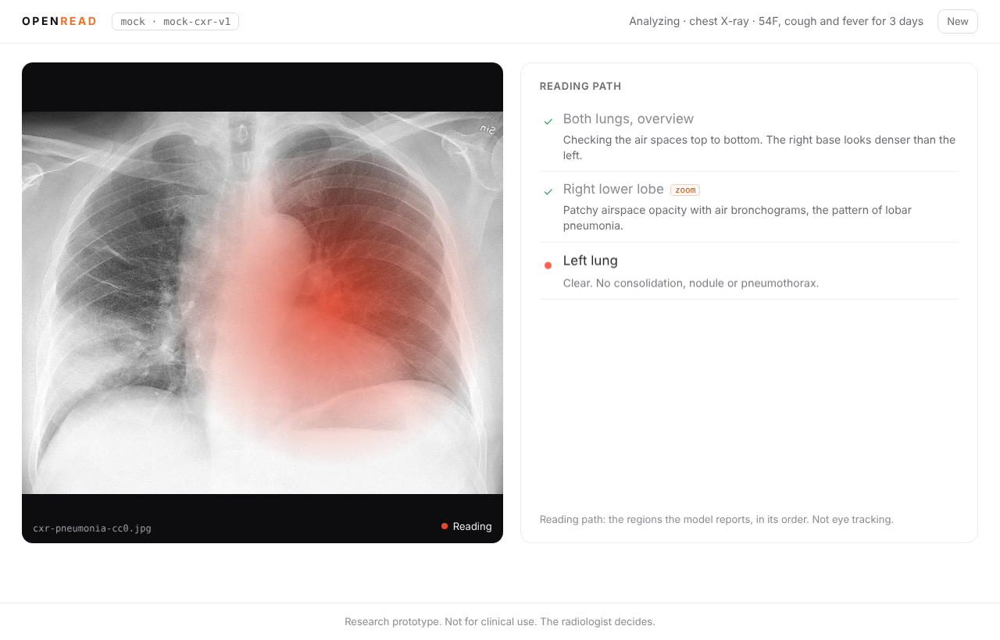
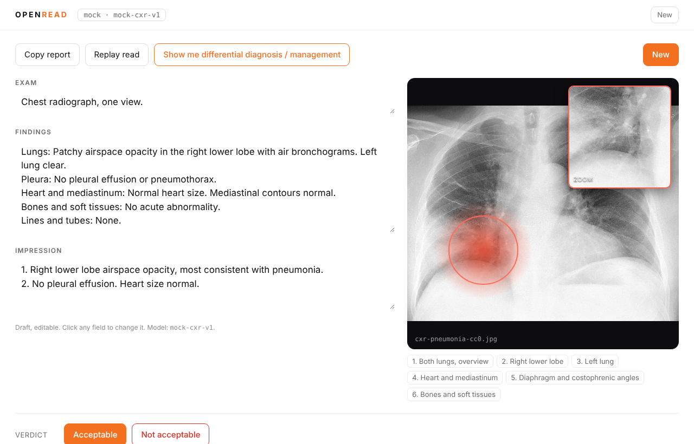
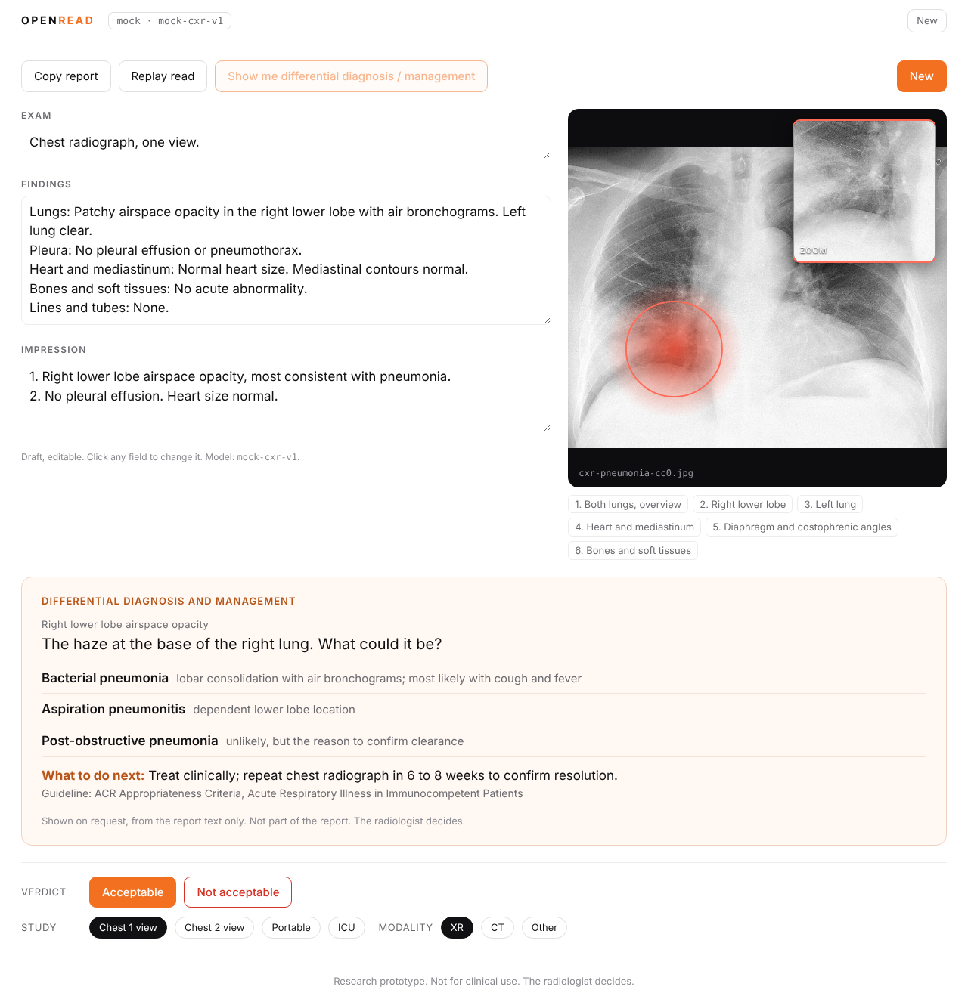

# OpenRead

**An open-source chest X-ray reader that shows its work.** A vision language model reads the film, reports the regions it looked at in order, and drafts a radiology report. The UI shows that reading path live as a red cloud moving over the image, then gives you an editable Exam / Findings / Impression, a one-click differential diagnosis and management panel, and a two-button rating that feeds a per-model benchmark.

Works with any OpenAI-compatible endpoint (OpenAI, OpenRouter, vLLM, Ollama), the Anthropic API, or Amazon Bedrock. Ships with a mock engine so it runs with no API key.



> **Research prototype. Not for clinical use. The radiologist decides.**
> OpenRead is for exploring how vision language models read radiographs. It is not a medical device, it has not been validated, and nothing it produces should be used to diagnose or treat a patient.

## 5-minute quickstart

```bash
git clone <this repo> openread && cd openread
cp .env.example .env          # ENGINE=mock works with no key
npm install
npm run dev                   # API on :8787, web on :5173
```

Open http://localhost:5173, click **Try the sample image**, then **Analyze**. You will see the mock engine stream a six-region reading path and a report.

To use a real model, edit `.env`:

```ini
# OpenAI
ENGINE=openai-compatible
MODEL=gpt-4o
OPENAI_API_KEY=sk-...

# Anthropic
ENGINE=anthropic
MODEL=claude-sonnet-4-5
ANTHROPIC_API_KEY=sk-ant-...

# Amazon Bedrock (standard AWS credential chain)
ENGINE=bedrock
MODEL=us.anthropic.claude-sonnet-4-5-20250929-v1:0
AWS_REGION=us-east-1
```

Restart `npm run dev` after changing `.env`.

### Local models: vLLM or Ollama (MedGemma, Qwen3-VL)

Any server that speaks the OpenAI chat completions API with `image_url` content works.

```bash
# vLLM with MedGemma
vllm serve google/medgemma-4b-it --max-model-len 8192
# .env
ENGINE=openai-compatible
OPENAI_BASE_URL=http://localhost:8000/v1
MODEL=google/medgemma-4b-it

# Ollama with Qwen3-VL
ollama pull qwen3-vl
# .env
ENGINE=openai-compatible
OPENAI_BASE_URL=http://localhost:11434/v1
MODEL=qwen3-vl
```

Leave `OPENAI_API_KEY` empty for local servers. If your server does not stream, set `OPENAI_NO_STREAM=1`; OpenRead will emit the whole reading path at the end instead of live. Small models sometimes wrap the JSON in code fences or add prose; the parser tolerates both. If a model keeps returning unparseable output, the UI shows the raw text so you can tune the prompt in `server/lib/prompt.js`.

## What you see

1. **Intake.** Paste (Ctrl+V), drop, or choose a chest X-ray. Add a history line. Click the orange **Analyze**.
2. **Reading.** The image on the left, the reading path on the right. As each region arrives from the model, a red translucent cloud eases (600 ms) to the centre of that region's box. When the model flags `zoom: true`, the cloud tightens, a ring appears, and a magnified inset of that box shows top right. The list marks the current region. The caption says what this is: *the regions the model reports, in its order. Not eye tracking.* `prefers-reduced-motion` turns the easing off.
3. **Report.** Exam, Findings and Impression, all editable. **Copy report** copies plain text. **Replay read** runs the path again. **Show me differential diagnosis / management** sends only the report text (never the image) to the model and renders a tinted panel: for each finding, the clinical question, differentials with a reason, and a next step with the guideline it rests on.
4. **Rating.** Orange **Acceptable** or outlined red **Not acceptable** (with a reason box), plus chips for study type, ICU and modality. Stored in `data/openread.db` with the model name and a hash of the report.
5. **New** clears everything.




## The JSON contract

Every engine uses the same system prompt (`server/lib/prompt.js`) and the model must answer with one JSON object:

```json
{
  "reading_path": [
    { "region": "Both lungs, overview", "box": [0.08, 0.12, 0.84, 0.72], "note": "Right base looks denser than the left.", "zoom": false },
    { "region": "Right lower lobe", "box": [0.12, 0.52, 0.32, 0.30], "note": "Airspace opacity with air bronchograms.", "zoom": true }
  ],
  "report": {
    "exam": "Chest radiograph, one view.",
    "findings": "Lungs: ...\nPleura: ...\nHeart and mediastinum: ...\nBones and soft tissues: ...\nLines and tubes: ...",
    "impression": "1. ...\n2. ..."
  }
}
```

- `box` is `[x, y, w, h]` as fractions of the image in 0..1 from the top-left. Values above 1 are treated as percentages and rescaled; everything is clamped.
- `zoom: true` marks a region worth a closer look. The UI tightens the cloud and shows the inset.
- The model is asked to emit `reading_path` before `report` so the path can be shown while the report is still being written.

The server parses tolerant of code fences, prose before or after the object, trailing commas and truncated output (`server/lib/json.js`). While the response streams, an incremental scanner (`PathScanner`) emits each `reading_path` item the moment its object closes, without waiting for the rest.

### Streaming API

`POST /api/analyze` with `{ imageBase64, mime, history, imageName }` answers with Server-Sent Events:

```
event: start   data: { "engine": "anthropic", "model": "claude-sonnet-4-5" }
event: path    data: { "item": { "index": 0, "region": "...", "box": [..], "note": "...", "zoom": false } }
event: path    data: ...
event: report  data: { "report": { "exam": "...", "findings": "...", "impression": "..." } }
event: done    data: { "readId": 12, "reportHash": "b4df0ecab34ee51d", "durationMs": 8120 }
event: error   data: { "message": "...", "raw": "first 2000 chars of model output" }
```

The client reads it with `fetch` and a `ReadableStream`, so it works over POST (see `web/src/api.js`).

Other routes: `GET /api/config`, `GET /api/samples`, `POST /api/ddx` (`{ report }` or `{ text }`), `POST /api/rate`, `GET /api/benchmark/summary`, `GET /api/benchmark.csv`, `GET /api/benchmark/next-unrated`.

## Benchmark workflow: comparing two models

Ratings are stored per model, so comparing models is a matter of generating reads with each and rating them blind.

```bash
# 1. Put your test images in samples/ (CC0 or your own de-identified set; nothing leaves your machine except to the model you configured).

# 2. Generate reads with model A, three per image
ENGINE=openai-compatible MODEL=google/medgemma-4b-it npm run bench -- --n 3

# 3. Generate reads with model B
ENGINE=anthropic MODEL=claude-sonnet-4-5 npm run bench -- --n 3

# 4. Rate them. In the UI, click "Rate bench reads" in the footer: it loads the oldest
#    unrated read (image, path and report) and you give the verdict. Repeat until empty.

# 5. Compare
curl -s localhost:8787/api/benchmark/summary | jq .
curl -s localhost:8787/api/benchmark.csv > results.csv
```

`summary` returns the acceptable rate per model per study type, plus how many reads each model has and how many are still unrated. The CSV is one row per read joined with its rating, including `duration_ms` and the `report_hash`, so you can also check how consistent a model is across its N runs of the same image (identical hashes mean identical reports).

Bench reads are rated blind: the UI does not show which model produced them. The verdict is joined to the model through the read id on the server.

## Project layout

```
server/            Express API (ESM)
  index.js         routes: /api/analyze (SSE), /api/ddx, /api/rate, /api/benchmark*
  engines/         one interface, four engines
    base.js        makeEngine(): wraps a text generator into analyze()/complete()
    openai-compatible.js  anthropic.js  bedrock.js  mock.js
  lib/prompt.js    the system prompt and the JSON contract
  lib/json.js      tolerant parser + incremental PathScanner
  lib/db.js        better-sqlite3: reads, ratings, summary, CSV
web/               Vite + React, plain JSX
  src/App.jsx      intake, reading, replay
  src/Film.jsx     the image, the cloud, the ring, the zoom inset
  src/ReportView.jsx  report, ddx panel, rating
scripts/bench.mjs  run samples/ through the engine N times
scripts/smoke.mjs  Playwright end-to-end run on the mock engine, writes docs/screens/
test/              node:test unit tests
samples/           CC0 sample images
data/              SQLite database (gitignored)
```

## Tests

```bash
npm test          # node:test: JSON parser, PathScanner, engines, db
npm run smoke     # Playwright smoke on the mock engine; screenshots to docs/screens/
                  # set CHROME=/path/to/chrome if Chromium is not at the default path
```

## Hackathon ideas

- **Prompt tuning per model.** Small open models need firmer instructions on box coordinates and on emitting `reading_path` first. Try few-shot examples, or ask for one region per line and adapt `PathScanner`.
- **Lateral view support.** Accept two images, add a `view` field to each path item, and show two films side by side.
- **Prior comparison.** Drop a prior study, add a `change` field (`new`, `improved`, `worse`, `stable`) to the report, and let the cloud jump between current and prior.
- **CT series.** Replace the single image with a stack; `box` becomes `[x, y, w, h, slice]` and the film becomes a scrollable viewer.
- **Blind A/B rating mode.** Show two reports for the same image, hide the model, record which one the reader prefers.
- **Fine-tuned region heads.** Compare the model's reported boxes against a segmentation model's lung fields to measure how often the model looks where it says it looks.
- **Voice.** Dictate a correction, apply it to the draft, store the diff as a training signal.
- **Teaching mode.** Hide the model's path, ask a trainee to mark theirs, then overlay the two.

## Disclaimer

OpenRead is a research prototype. It is not a medical device, has not been cleared or approved by any regulator, and must not be used for diagnosis, treatment or any clinical decision. Output can be wrong, including confidently wrong. Never upload images that contain protected health information to a third-party model without the agreements your institution requires. The radiologist decides.

## Credits and license

MIT License, copyright 2026 DICTORA, Inc. and contributors. See `LICENSE`.

Sample image: lobar pneumonia chest radiograph by Mikael Häggström, CC0, via Wikimedia Commons. See `CREDITS.md`.
